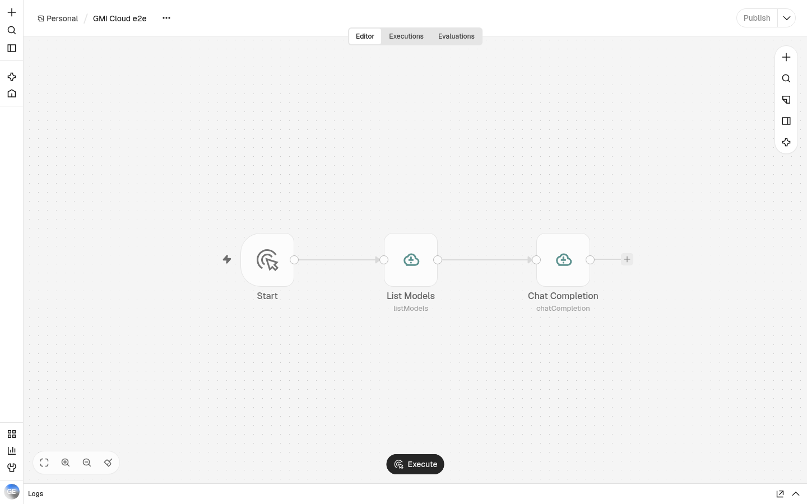
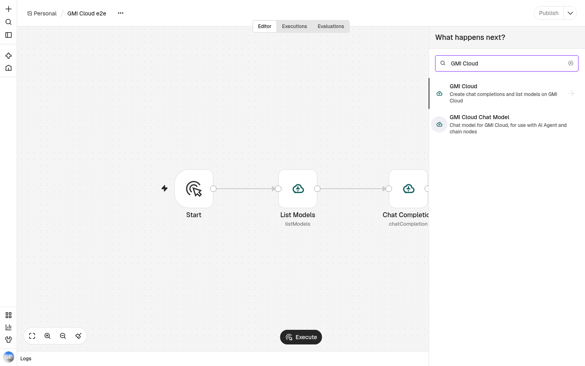
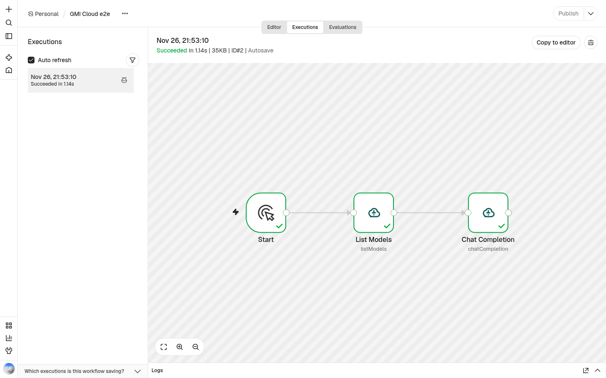

# n8n-nodes-gmicloud

This is an n8n community node for [GMI Cloud](https://www.gmicloud.ai/). It connects n8n to GMI's OpenAI-compatible inference API so you can list models, run chat completions, and plug GMI Cloud into AI Agent and chain nodes.

[n8n](https://n8n.io/) is a [fair-code licensed](https://docs.n8n.io/n8n-community-license/) workflow automation platform.

This project is independent and is not published by GMI Cloud.

- [Installation](#installation)
- [Credentials](#credentials)
- [GMI Cloud node](#gmi-cloud-node)
- [GMI Cloud Chat Model](#gmi-cloud-chat-model)
- [Compatibility](#compatibility)
- [Usage](#usage)
- [Development](#development)
- [Resources](#resources)
- [Version history](#version-history)
- [License](#license)

## Installation

Once the package is published to npm, install it from n8n:

1. Open **Settings → Community Nodes**.
2. Select **Install**.
3. Enter `n8n-nodes-gmicloud`.
4. Agree to the risks and install.

You can also follow the [community nodes installation guide](https://docs.n8n.io/integrations/community-nodes/installation/).

Until it is published, install from a local build or a git checkout on a self-hosted n8n instance:

```bash
# From this repository
npm install
npm run build

# In your n8n user folder (often ~/.n8n)
mkdir -p ~/.n8n/nodes
cd ~/.n8n/nodes
npm install /path/to/n8n-nodes-gmicloud
```

Restart n8n after installing. The **GMI Cloud** and **GMI Cloud Chat Model** nodes then appear in the node panel.

## Credentials

Create a **GMI Cloud API** credential:

1. Sign in at [console.gmicloud.ai](https://console.gmicloud.ai) and create an API key.
2. In n8n, add a **GMI Cloud API** credential.
3. Paste the API key.
4. Leave **Base URL** as `https://api.gmi-serving.com/v1` unless you have a dedicated endpoint.
5. Save. n8n tests the credential with `GET /v1/models`.

The key is stored encrypted by n8n and sent as a Bearer token. Do not commit it to git.

## GMI Cloud node

A regular n8n node with two operations:

| Operation | What it does |
| --- | --- |
| **Chat Completion** | Sends a prompt (and an optional system message) to a GMI Cloud model and returns the completion. The node also exposes a convenient `text` field. |
| **List Models** | Calls `GET /v1/models` and returns the model IDs available to your key. |

The model dropdown is loaded from the live catalog. You can also set a model ID with an expression.

Chat Completion options: temperature, maximum tokens, and top P.

## GMI Cloud Chat Model

A LangChain-compatible language-model sub-node. Connect it to **AI Agent**, **Basic LLM Chain**, or any other node that takes a Model input.

It uses n8n's official `supplyModel` helper (`@n8n/ai-node-sdk`) with GMI's OpenAI-compatible endpoint, so tool calling and streaming follow n8n's standard chat-model path. The model list is loaded dynamically from `/v1/models`.


## Screenshots

Captured on 26 Nov 2026 (Asia/Calcutta) against a local n8n 2.49.7 instance with this package loaded. The live e2e run listed 71 models and completed a 1-token `pong` reply.







## Compatibility

- Tested against current n8n 2.x (community node API version 1, AI node SDK version 1).
- Self-hosted n8n is required for unpublished / local installs.
- n8n Cloud can install the package only after it is published to npm and, for verified listing, submitted through the n8n Creator Portal.

## Usage

**List models, then ask a cheap model a short question**

1. Add a **GMI Cloud** node.
2. Select **List Models** to confirm your key can see the catalog.
3. Add another **GMI Cloud** node, select **Chat Completion**, pick a low-cost model such as `google/gemini-3.5-flash-lite`, and enter a short prompt. Some reasoning models spend `max_tokens` on hidden thinking and can return empty `text` unless you raise the limit.

**Use GMI Cloud with an AI Agent**

1. Add an **AI Agent** node.
2. Attach **GMI Cloud Chat Model** to the agent's Model input.
3. Choose a model from the dropdown and, if you want, lower temperature for more deterministic answers.

Keep `Maximum Tokens` small while you are testing so runs stay cheap.

## Development

```bash
npm install
npm run lint
npm test
npm run build
npm run dev   # starts n8n with this package loaded
```

End-to-end against a live GMI key (never printed):

```bash
export GMI_API_KEY=...
npm run test:e2e
```

## Resources

- [GMI Cloud](https://www.gmicloud.ai/)
- [GMI Cloud LLM API reference](https://docs.gmicloud.ai/inference-engine/api-reference/llm-api-reference)
- [n8n community nodes documentation](https://docs.n8n.io/integrations/community-nodes/)
- [Creating nodes](https://docs.n8n.io/integrations/creating-nodes/overview/)

## Version history

See [CHANGELOG.md](CHANGELOG.md).

## License

MIT. See [LICENSE](LICENSE).
